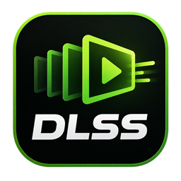
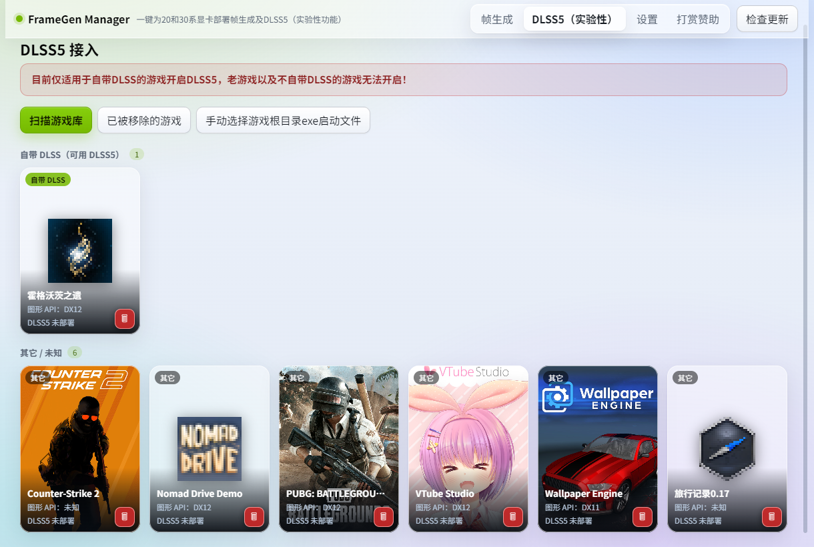
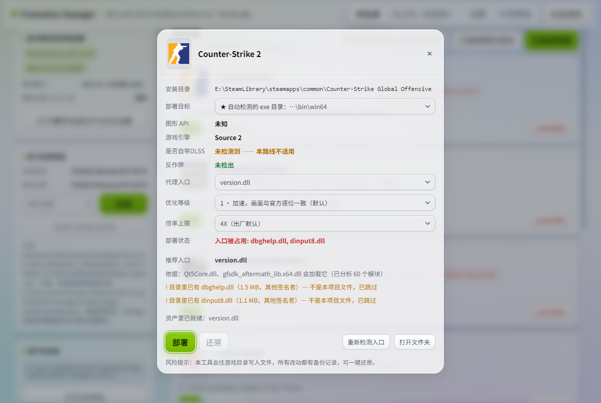
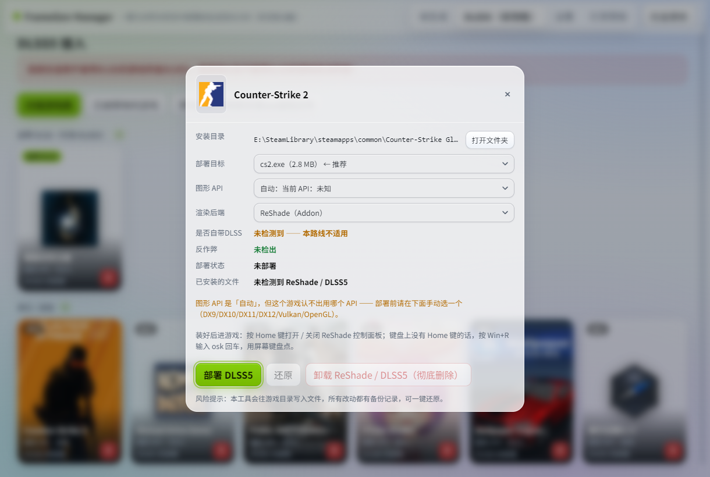

<h1 align="center">FrameGen Manager</h1>

  <b>One-click DLSS frame generation</b> for RTX 20 / 30 series GPUs, plus access to <b>DLSS 5</b> neural rendering (experimental)

  
  
  
  

  English | <a href="README.md">中文</a>

A Windows desktop tool that deploys the proxy DLL + config from
[sdli1995/dlssg_for_sm86](https://github.com/sdli1995/dlssg_for_sm86) into the folder holding
the game's rendering EXE, and handles the DLSS runtime, GPU routing and entry-point conflicts for you.

## Interface

| Game library (frame generation) | DLSS5 setup |
|---|---|
|  |  |
| **Frame generation deploy** | **DLSS5 deploy** |
|  |  |

Three always-visible cards on the left: GPU driver and system settings, **GPU name spoofing** (optional),
and the assets folder.
Five tabs across the top: Frame generation / Smooth Motion (experimental) / DLSS5 (experimental) / About / Sponsor.

> The screenshots above show the Chinese interface. **The app itself speaks English too** —
> the switch sits in the **top bar** (the dropdown next to the tabs). On first launch it follows your
> system language (Chinese if that is what Windows uses, English otherwise), and it remembers your
> choice; switching takes effect right away, no restart needed.
>
> Note: **log output is never translated** — it is written verbatim by the background process, so it
> reads the same in either language.

- **Frame generation**: deploys the upstream frame interpolation into games that do not support DLSS-FG (RTX 20 / 30 series)
- **Smooth Motion (experimental)**: unlocks NVIDIA's driver-level Smooth Motion — **RTX 30 series only**, driver >= 616.64 required
- **About**: version / paths / backups / feedback (QQ group 1125445047)

## Download and usage

- **Installer (recommended)**: grab `FrameGen-Manager-v<version>-setup.exe` from
  [Releases](../../releases) and double-click it. You can change the install folder
  (default `C:\Program Files\FrameGen Manager`).
  To uninstall, use Settings → Apps: **uninstalling it manually removes all data, while a silent
  uninstall (the kind performed during an update) keeps everything**.

**No runtime to install**
The interface renders with the GPU by default.

Frame generation, step by step:

1. Click **Scan library** at the top right to find Steam / Epic / WeGame games automatically. For games it
   cannot find, use **"Add a game manually (exe / launch folder)"** (the question mark at the top-left of the
   button explains it) and point at the folder holding the game's rendering EXE.
2. **No asset download needed**: the upstream proxy DLL, the INI and both DLSS runtimes ship inside the
   installer, so it works as soon as it is installed.
3. On the game's row click **Deploy** → choose the **deploy target** (the auto-detected exe folder, or pick
   the launch exe yourself), the proxy entry point and the deployment levels → click **Deploy**.

Once in game, turn on DLSS frame generation in the graphics settings.
**After installing DLSS5, press Home in game** to open / close the ReShade control panel.
(No Home key on your keyboard? Press Win+R, type `osk` and use the on-screen keyboard.)

> **Note**: the app has no code-signing certificate, so Windows may show "Windows protected your PC".
> Click **More info** → **Run anyway**.

## What it puts in the game folder

| File | Purpose |
|---|---|
| version.dll | Proxy entry point (under 1 MB; if the name is taken it automatically switches to winmm / dbghelp / dinput8 / dxgi / d3d12) |
| dlssg_sm86.ini | Configuration (optimization level, max multiplier, DLSS-G preset, frame-generation engine DLSS/XeSS, super-resolution boost; ships at the factory defaults) |
| dlssg_sm86\ | Runtime / backend / kernel folder (moved out of the proxy DLL as of upstream 0.4.0; deployed into the game folder as a whole folder) |

Everything goes into the folder holding the game's **actual rendering EXE** (usually `...\Binaries\Win64\`).

Files that would be overwritten are backed up first, and you can click **Restore** on the Deploy card at
any time to put the game folder back exactly as it was.

### RTX 20 and RTX 30 use the same files

As of upstream **0.4.0**, the root `version.dll` plus the stock `dlssg_sm86.ini` work on both RTX 20
(Turing / SM75) and RTX 30 (Ampere / SM86): **no keys to add**, the kernel family is picked from the
physical GPU. This tool therefore no longer distinguishes between the two generations, and there is no
"switch version" step — just click **Deploy** (the assets are bundled with the installer).

(History: upstream 0.3.0 could not enable frame generation on any RTX 20 card — it reported an
architecture to the NGX core that was not the real one, and the core rejected it outright. That is
upstream issues #491 / #492, fixed in 0.3.1.)

### Optimization level and max multiplier (chosen right in the Deploy card)

Since upstream 0.3.2 these two switches live as two drop-downs on the Deploy card, and **only the copy
deployed into the game folder is written** (the originals in the assets folder are left alone):

- **Optimization level** `Optimized`: `0` stock kernels, no acceleration / **`1` fully accelerated with
  output bit-identical to official (factory default)** / `2` adds lossy image kernels (faster; PSNR vs.
  official still above roughly 50 dB) / `3` fully lossy (fastest). Levels `2` and `3` only work on the
  latest runtime (310.9), and the output is no longer bit-identical to official.
- **Max multiplier** `MaxGeneratedFrames`: **4X (factory default)** / 6X (written as 5; supported only by
  the latest runtime, and the game's bundled plugin has to support it too).

With both left at their defaults the tool **does not change a single character** and uses the upstream
file as-is; only if you change a level does it write a deployment-specific INI.

> 📌 Since upstream **0.3.3**, level `1` no longer skips duplicated real-frame copies
> (`SkipRepeatedRealCopy`, off by default in every level): on 0.3.2 some users saw flickering
> (upstream issue #532). **Upgrading to 0.3.3 fixes it.**

### Super-resolution boost and the frame-generation engine (Deploy card, advanced)

Three more drop-downs on the Deploy card write the upstream INI keys for you (all optional; anything
left at its factory default writes nothing):

- **Super-resolution boost** `[SuperResolution] Mode`: on RTX 20 / 30, when the game uses DLSS
  Performance / Ultra Performance (presets L / M), that mode runs this project's INT8 kernels —
  faster super-resolution, slightly lower quality; the game's own DLSS preset is not changed. Off by default.
- **Frame-generation engine** `[FrameGeneration] Engine`: `DLSS` (default; NVIDIA's DLSS-G model,
  up to 4X/6X) or `XeSS` (experimental; Intel's XeSS-FG model on this project's own runner, 2X only,
  falls back to DLSS on back-buffer formats it cannot run).
- With `XeSS` selected, two more options appear: **Optical-flow resolution** (`Coarse` / `Medium` /
  `Fine` — finer is slower) and **Composite HUD-less frame** (`UseHudless`).

Only values that differ from the factory defaults are written into the game's INI; switching back to
a default removes the key again on the next deploy.

**DLSS5 (new)**

- One-click **automatic deployment**: the official ReShade installer runs silently (the installer itself
  is bundled)
- Opening the deploy dialog **detects what is already installed** — it does not rely on this tool's
  records, so a manual install of yours is recognised too
- **Uninstall ReShade / DLSS5 (delete permanently)**: the official uninstaller removes ReShade itself,
  ReShade.ini and ReShade.log plus the shader preset folder, then this tool removes the preset, the
  plugin, the model and plugin-runtime leftovers, and finally re-checks. You get a second confirmation
  with every file listed before anything runs
- After deployment it reminds you to press **Home** in game to open the panel (no Home key: Win+R → `osk`)

**Frame generation**

- **Manually installed setups can be cleaned up too**: when the frame generation files in the folder were
  not placed by this tool (no backup record), the restore button becomes **Clean up manual install**.
  Files are identified by content first: only files that byte-for-byte match a version this tool has
  ever shipped are deleted (permanently, not to the Recycle Bin). Same-named files whose content does
  not match are **kept and reported** in the result, so game originals cannot be wiped by mistake.
- The installer **bundles every asset**: deploy immediately after installing, no ~95 MB download to wait for
- The **deploy target** is now a drop-down: the auto-detected rendering EXE folder, or a launch exe you pick

## DLSS5 (experimental)

Brings DLSS 5 neural rendering to games that **ship with DLSS** (through a ReShade plugin, independent
of frame generation).

- **One-click deployment**: on the DLSS5 page pick a game → check the files it will install → click
  **Deploy DLSS5**. The whole thing is automatic: the official ReShade installer runs silently (the
  installer is unpacked from the bundled copy; no network, no clicking through dialogs), then the plugin
  and model are laid down, and finally everything is verified by SHA256. Only two situations need you:
  Vulkan mode asks for UAC once, and a game that was not fully closed so its files are locked (it reports
  an error instead of writing something broken).
- **How to use it once installed**: press **Home** in game to open / close the ReShade control panel.
  With no Home key, press **Win+R**, type **osk** and press Enter, then use the on-screen keyboard.
  The overlay text in the top-left corner is **the plugin's own status notice** and only appears while
  neural rendering is inactive — turn it on in the ReShade overlay under Add-ons → DLSS 5 Neural
  Rendering (or press the NR hotkey it lists) and the notice stops appearing.
- **It detects, and it uninstalls cleanly**: the deploy dialog shows **Installed files**. **It works
  without relying on this tool's records** — a ReShade / plugin / model you installed by hand is found
  just the same, and you get an **"Uninstall ReShade / DLSS5 (delete permanently)"** action: the official
  uninstaller removes ReShade itself + ReShade.ini + ReShade.log + the shader preset folder, then this
  tool removes the preset, plugin, model and plugin-runtime leftovers, and re-checks. This is a
  **permanent deletion (not to the Recycle Bin)** and asks for confirmation with every file listed first.
- **Which GPUs the model covers**: the bundled neural model only works on the 20 / 30 series
  (SM86 / SM75); other GPUs are blocked.

## GPU name spoofing (advanced · optional · use with care)

> ⚠ **This feature is not required.** Only try it when the frame generation option never appears in a
> particular game *and* you have already deployed normally with the three steps above.

A handful of games decide whether to expose their frame generation setting purely from the GPU model,
and classify RTX 20 / 30 series as unsupported.

> 💡 **Try the latest version first**: since upstream **0.3.3** the reported GPU architecture is changed
> to RTX 50 when the game starts, so games that judge by model or architecture (including Streamline 2.8
> titles such as *Final Fantasy VII Rebirth*) **open up by default** — no registry edit needed. Only if
> the option still does not appear on the latest version should you consider the two approaches below.
>
> 💡 Next, prefer the INI key: upstream provides `[Compatibility] SpoofArchToGame`, which is **written to
> the INI only** — put it in the `dlssg_sm86.ini` deployed into the game folder. It affects that one game,
> never touches the registry, and needs no administrator rights. If you can use it, do not use the
> registry method below.

- **Changes exactly one value**: `HKLM\SYSTEM\CurrentControlSet\Enum\PCI\<your GPU>\<instance>\DeviceDesc`.
  `HardwareID`, `CompatibleIDs`, `Driver`, `Service` and `Mfg` are never touched.
- The model **can only be picked from a fixed list** (RTX 5090 / RTX 5060), no free-form input — precisely
  so a wrong model cannot be entered.
- Before writing, the original value is backed up to `backups\gpu-name` next to the program and **read back
  for verification**. If verification fails it aborts and never touches the registry.
- Administrator rights are required (you get one UAC prompt), and it **only takes effect after a reboot**.
- It can be reverted at any time, to either target:
  - **Restore the name recorded by the driver** — removes the spoof entirely, back to your real model
  - **Restore the value from before the change** — back to the state before this tool ever touched it

**Side effects (please read these before clicking Apply):**

1. The GPU name and hardware ID no longer match, so **kernel-level anti-cheat may flag it as abnormal —
   there is a ban risk**
2. NVIDIA App / the driver installer may misidentify the model, causing driver updates or "optimisation"
   to fail
3. It is reset by a driver reinstall or a major driver update, and has to be set again
4. The GPU name shown in dxdiag, Device Manager and Task Manager changes too
5. **It is not guaranteed to work**: if a game judges the model from the hardware ID, renaming does nothing
6. Some NVIDIA features that key off the model (DLSS overrides, control panel options) may be affected

## License

[MIT](LICENSE). Third-party component licences are in [THIRD_PARTY_NOTICES.txt](THIRD_PARTY_NOTICES.txt).

Build, test, packaging and implementation notes are in [DEVELOPING.md](DEVELOPING.md).
